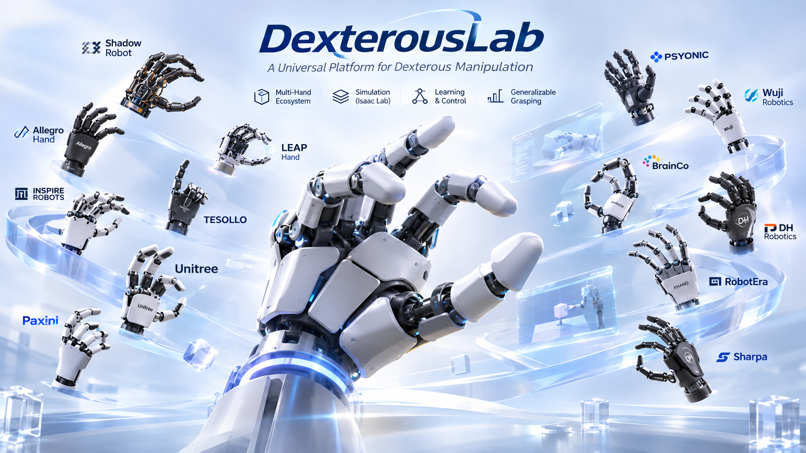
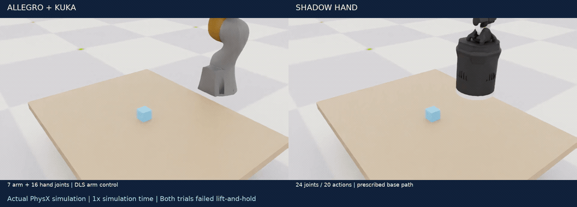
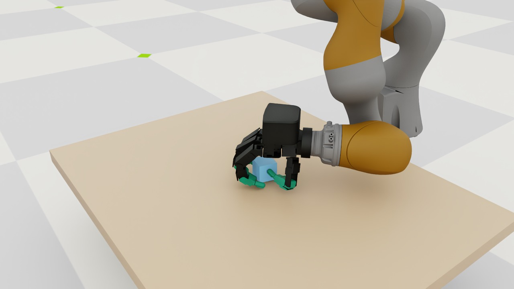
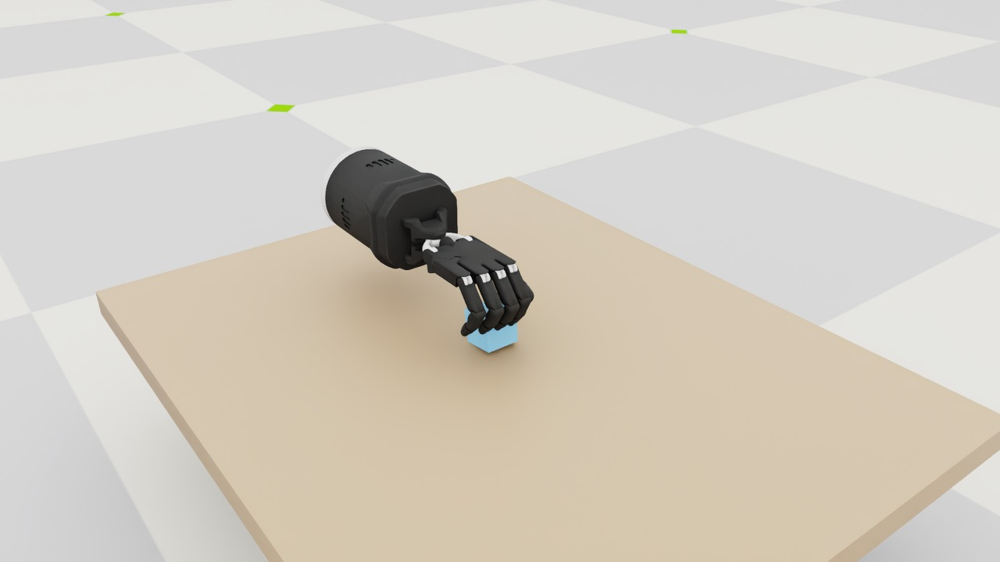

<h1 align="center">
  
</h1>

<p align="center">
  <a href="README.md">简体中文</a> &nbsp; | &nbsp; <strong>English</strong>
</p>

<p align="center">
  🔬 Research Preview &nbsp; · &nbsp; 🐍 Python 3.12 &nbsp; · &nbsp; ⚛️ PhysX &nbsp; · &nbsp; 🧩 Configuration driven &nbsp; · &nbsp; 🤖 IsaacLab-Arena
</p>

<p align="center">
  <br />
  <sub>Concept artwork · <a href="docs/media/README.md">Image sources</a></sub>
</p>

<a id="news"></a>

## 📰 News

- **2026-11-10** — Released real simulation recordings of Allegro and Shadow, with 16 seconds of footage per hand. [Watch the videos](#motion-video)
- **2026-11-10** — Open-sourced the project code, configurations, documentation, and experiment records.

<a id="introduction"></a>

## 🧭 Introduction

**DexterousLab** is an open-source research framework for dexterous grasping and simulation data collection, built on NVIDIA Isaac Sim, Isaac Lab, and IsaacLab-Arena. Configure hands, objects, tabletop scenes, and tasks, run control experiments, and save joint states, object states, contact data, and results to support algorithm integration and comparative studies.

<a id="installation"></a>

## 📦 Installation

**Requirements:** Linux, an NVIDIA GPU with a working driver, and Git. Installing Arena for the first time also requires `uv`. Run the following commands in the same terminal.

### 1. Clone the project

```bash
git clone https://github.com/ShunZuo-AI/DexterousLab.git
cd DexterousLab
export DEXLAB_ROOT="$PWD"
```

### 2. Select an Arena environment

**Already have a working Arena installation?** Set its path and continue to step 3. The current server uses:

```bash
export DEXLAB_ARENA_ROOT=/root/gpufree-data/IsaacLab-Arena
```

**Installing Arena for the first time?** Create it alongside DexterousLab:

```bash
cd "$DEXLAB_ROOT/.."
git clone https://github.com/isaac-sim/IsaacLab-Arena.git
cd IsaacLab-Arena
git checkout 5fb3bd8a639578d46f4b5ed67b9b5239e1281b9a
git submodule update --init --recursive
uv sync --extra dev
export DEXLAB_ARENA_ROOT="$PWD"
```

> The fresh-install procedure has not been validated on a clean machine. The working server has local lockfile changes, so pinning the source commit does not guarantee identical dependencies. Skip `uv sync` if your environment already works. [Installation details and version records](docs/installation.md)

### 3. Enable the CLI

After reading and accepting the Isaac Sim EULA, run:

```bash
cd "$DEXLAB_ROOT"
export OMNI_KIT_ACCEPT_EULA=YES ACCEPT_EULA=Y
export PATH="$DEXLAB_ROOT/scripts:$PATH"
dexlab doctor
```

`doctor` should report `ready: true`. DexterousLab reuses Arena's `.venv`; the launcher configures the Torch CUDA library path automatically.

### 4. Verify a scene

```bash
# Check the configuration
dexlab scene run --hand allegro --object cube --physics physx --dry-run

# Run 20 simulation steps with zero actions
dexlab scene run --hand allegro --object cube --physics physx --steps 20
```

Models and caches are not included in the Git clone. The first run may need internet access to retrieve official assets. Completing 20 steps verifies that the environment runs; grasp experiments follow below. [Troubleshooting](docs/installation.md#6-常见问题)

<a id="quick-start"></a>

## 🚀 Quick Start

After installation, run these commands from the project directory.

### Switch hands and objects

```bash
# Allegro + Cube
dexlab scene run --hand allegro --object cube --physics physx

# Allegro + Cylinder
dexlab scene run --hand allegro --object cylinder --physics physx

# Shadow + Cube
dexlab scene run --hand shadow --object cube --physics physx
```

By default, each command runs **1 environment for 100 steps in headless mode**. These are zero-action smoke tests, not evaluations of grasping ability.

### Run a grasp attempt

Prepare the official asset cache using the [asset setup instructions](docs/installation.md#5-资产录制与测试), then choose a hand:

```bash
"$DEXLAB_ARENA_ROOT/.venv/bin/python" scripts/first_grasp_experiment.py --hand allegro
"$DEXLAB_ARENA_ROOT/.venv/bin/python" scripts/first_grasp_experiment.py --hand shadow
```

| Item | Details |
|---|---|
| Sequence | Approach → close → lift → hold, over 480 environment steps |
| Configuration | [configs/experiments/first_grasp.toml](configs/experiments/first_grasp.toml) |
| Output | A separate run directory under `outputs/` for each attempt |
| Video | Add `--record-video` for offscreen recording |
| Screenshots | Add `--render` in a configured remote desktop session |

<a id="experiments"></a>

## 🧪 Experimental Results

**Both hands completed real simulation and control attempts, but neither met the criterion of lifting and holding the cube.**

| Experiment | Environment / physics steps | Grasp result |
|---|---|---|
| Allegro + KUKA · Cube | 480 / 1920 | Did not successfully lift and hold |
| Shadow · Cube | 480 / 1920 | Did not successfully lift and hold |

Allegro is mounted on a KUKA arm; Shadow follows a kinematic base trajectory. These runs use different control setups and document the current baseline. [Experiment report and logs](docs/experiments/first_grasp_experiment.md)

<a id="motion-video"></a>

### Simulation Videos

[](docs/media/motion-20261110/comparison.mp4)

[▶ Comparison](docs/media/motion-20261110/comparison.mp4) &nbsp; · &nbsp; [Allegro](docs/media/motion-20261110/allegro.mp4) &nbsp; · &nbsp; [Shadow](docs/media/motion-20261110/shadow.mp4) &nbsp; · &nbsp; [Recording details](docs/experiments/motion-video-20261110.md)

Each hand is recorded for **16 seconds · 15 FPS · 480 environment steps**, showing approach, closing, lifting, and holding phases.

### Closing Phase Screenshots

| Allegro + KUKA | Shadow |
|---|---|
|  |  |

Recorded unit test result: **111 passed**. [Test log](docs/experiments/first_grasp_final_tests.log)

<a id="documentation"></a>

## 📚 Documentation

The supporting documents below are currently primarily in Chinese.

| Document | Contents |
|---|---|
| [Installation guide](docs/installation.md) | Environment setup, version records, and troubleshooting |
| [Usage reference](docs/reference/usage-details.md) | Commands and configuration parameters |
| [Architecture and directories](docs/architecture.md) | Module responsibilities and extension points |
| [Development guide](docs/development.md) | Coding conventions, module boundaries, and testing |
| [Asset preview](docs/asset-preview.md) | Visual model previews |
| [Data collection and evaluation](docs/research/dexgarmentlab_usage.md) | Collection, replay, and batch evaluation |
| [Data contract](docs/data-contract.md) | Data formats, units, and coordinate conventions |
| [Paper implementation analysis](docs/paper_reproductions/README.md) | Source analysis and algorithm migration status |

First-party code is licensed under [Apache 2.0](LICENSE). Third-party models, paper components, and images retain their respective licenses: [algorithm attribution](docs/paper_reproductions/ATTRIBUTION.md) · [image sources](docs/media/official-products/README.md).
