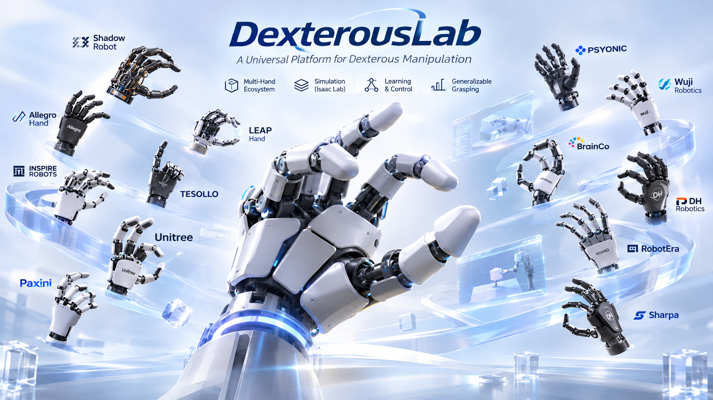
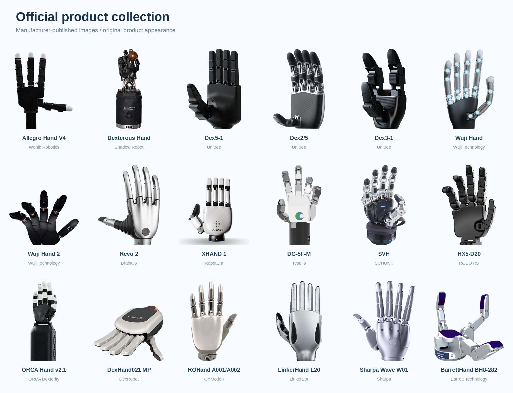
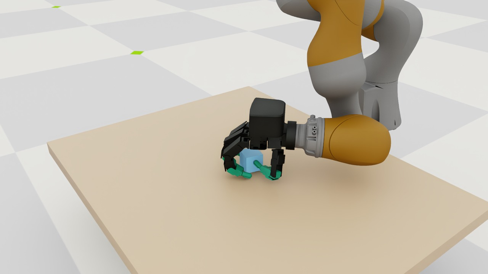
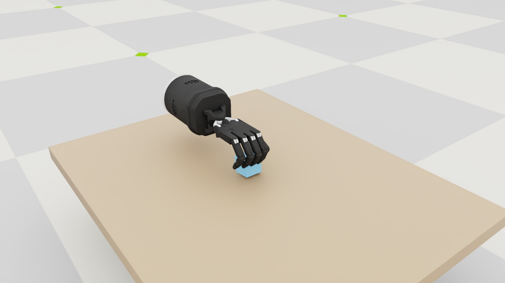
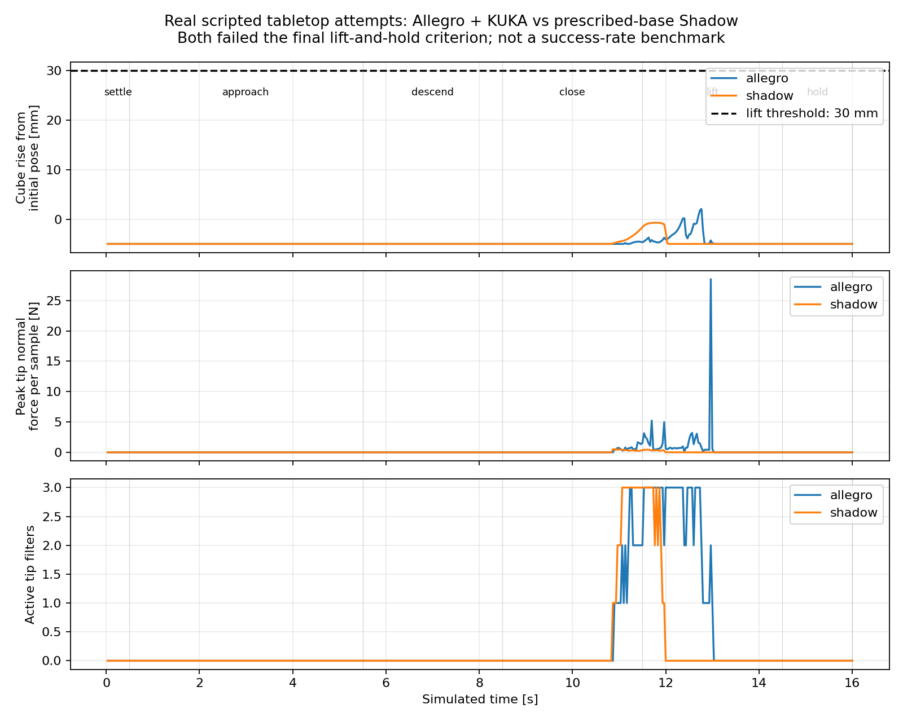
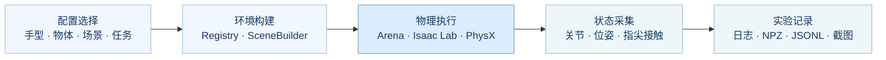

<p align="center">
  
</p>

<p align="center">
  <strong>多种灵巧手 · 可组合的场景 · 可复核的实验</strong><br />
  A shared workspace for dexterous manipulation research.
</p>

<p align="center">
  
</p>

<p align="center">
  <a href="#overview">项目概览</a> &nbsp; · &nbsp;
  <a href="#quick-start">快速开始</a> &nbsp; · &nbsp;
  <a href="#hand-assets">灵巧手资产</a> &nbsp; · &nbsp;
  <a href="#experiments">实验展示</a> &nbsp; · &nbsp;
  <a href="#architecture">框架逻辑</a> &nbsp; · &nbsp;
  <a href="#documentation">文档中心</a>
</p>

<p align="center">
  <sub>封面为概念视觉，图中品牌与能力文案不作为已实现功能的证明。<a href="docs/media/README.md">图片来源</a></sub>
</p>

---

<a id="overview"></a>

## 项目概览

**DexterousLab 是一个面向多指灵巧抓取研究的配置驱动框架。** 基于 Isaac Sim、Isaac Lab 与 IsaacLab-Arena，将资产管理、场景构建、动作执行、状态采集和结果评测连接到同一工作流。

选择手型与物体，组合桌面实验，观察真实物理过程，再把配置、动作、接触和结果保存为可追溯的研究记录。

<table>
  <tr>
    <td align="center" width="25%"><h2>22</h2>通过物理验证的资产配置<br /><sub>型号 / 左右手 / 版本分别计数</sub></td>
    <td align="center" width="25%"><h2>17</h2>覆盖的厂商 / 项目<br /><sub>以已通过资产级验证的记录计</sub></td>
    <td align="center" width="25%"><h2>2</h2>已接入桌面任务的手型<br /><sub>Allegro · Shadow</sub></td>
    <td align="center" width="25%"><h2>3</h2>程序化物体类型<br /><sub>Cube · Cylinder · Sphere</sub></td>
  </tr>
</table>

### 从资产到实验

| 资产与配置 | 场景与物理 | 观测与结果 |
|---|---|---|
| 来源、commit 与许可记录 | Arena 组件与环境构建 | 关节、手掌和物体状态 |
| 文件校验与 URDF→USD 转换 | 独立的手型与接触映射 | 指尖法向力与接触点 |
| 模型预览与资产级验证 | 小规模 PhysX 运行 | 配置快照、轨迹与实验日志 |

> **研究状态**　实验基础设施已可用，可靠抓取闭环仍在开发。首次 Allegro / Shadow 有动作实验均未达到抬升保持标准；完整论文复现、通用抓取生成器及物理验证器尚未完成。

<a id="quick-start"></a>

## 快速开始

以下命令针对**当前已经安装并验证的 GPUFree 服务器**。共享环境为 `/root/gpufree-data/IsaacLab-Arena/.venv`，项目代码与自有资产位于 `/root/gpufree-data/DexterousLab`。当前采用源码方式运行，尚未验证独立 wheel 或任意机器上的全新安装流程。

### 01 · 检查环境

```bash
cd /root/gpufree-data/DexterousLab
export PATH="$PWD/scripts:$PATH"

dexlab doctor
dexlab assets list
dexlab scene list
```

启动器自动使用已有 Python，并在启动前将 Torch CUDA 动态库目录加入 `LD_LIBRARY_PATH`。无需新建 conda / venv、重新安装 Isaac Sim 或执行 `uv sync`。Arena 路径变化时，设置 `DEXLAB_ARENA_ROOT` 指向对应 checkout。

### 02 · 运行桌面场景

```bash
# 先检查配置，不启动仿真
dexlab scene run --hand allegro --object cube --physics physx --dry-run

# 每组默认1个环境、100个环境步，无窗口运行
dexlab scene run --hand allegro --object cube --physics physx
dexlab scene run --hand allegro --object cylinder --physics physx
dexlab scene run --hand shadow --object cube --physics physx
```

这些命令执行 **zero-action 冒烟测试**，用于检查机器人、物体、物理属性和仿真步进。它们不执行抓取动作，也不产生抓取成功结论。当前 scene CLI 支持 PhysX；未知手型、物体或未实现后端会明确报错。

### 03 · 执行抓取尝试

```bash
# 使用同一个共享Python；脚本自动设置运行环境
/root/gpufree-data/IsaacLab-Arena/.venv/bin/python \
  scripts/first_grasp_experiment.py --hand allegro

/root/gpufree-data/IsaacLab-Arena/.venv/bin/python \
  scripts/first_grasp_experiment.py --hand shadow
```

实验依次执行 `settle → approach → descend → close → lift → hold`，每次运行 **480 个环境步 / 1920 个物理步**。参数来自 [first_grasp.toml](configs/experiments/first_grasp.toml)。在已配置图形会话的云桌面上追加 `--render`，可保存各阶段视口截图；首次渲染可能需要编译着色器。

<details>
<summary><strong>机器人控制方式与实验对照边界</strong></summary>

Allegro 桌面机器人是 **KUKA iiwa7 + Allegro**，共 23 个物理关节和 23 维动作。Shadow 是独立手，具有 **24 个物理关节、16 个直接关节电机及 4 个腱控制量**，动作维度为 20。Shadow 当前实验使用规定的运动学基座路径，两组结果不作为同硬件性能排名。

</details>

<a id="hand-assets"></a>

## 灵巧手资产

<details>
<summary><strong>展开查看带型号名称的 18 张官方商品图</strong></summary>



</details>

资产清单当前包含 **147 条登记记录**，其中 **64 个原始资产变体已下载**，**22 个型号 / 版本配置记录通过 100 步资产级物理验证**。左右手和不同版本分别计数，登记数量不等于可运行机器人数量。

<details>
<summary><strong>查看已通过资产级验证的手型</strong></summary>

| 系列 | 已记录通过资产级验证的配置 |
|---|---|
| Wonik / Shadow Robot / LEAP | Allegro Hand、Shadow Hand、LEAP Hand V1 |
| Unitree | Dex1-1、Dex2-5、Dex3-1、Dex5-1 |
| Wuji | Hand V1、Hand V2.1、Hand V2.2 |
| BrainCo / RobotEra / Tesollo | Revo2、XHand、DG5F |
| PSYONIC / SCHUNK / Barrett | Ability Hand、SVH、Barrett Hand |
| ROBOTIS / ORCA / DexRobot | HX5、ORCA Hand、DexHand021 |
| OYMotion / LinkerBot / Sharpa | ROHand、LinkerHand L20、Sharpa Wave |

</details>

**桌面任务适配与资产级验证分开维护。** 目前 `scene run --hand` 对应 Allegro 和 Shadow；其他手型可通过资产入口检查、验证或预览，仍需各自的关节、腱、掌坐标、接触映射和执行器适配。

```bash
dexlab assets manufacturers
dexlab assets hands --manufacturer unitree
dexlab assets inspect --id unitree/dex5_1/right

# 在云桌面打开模型预览，默认保持10分钟
dexlab assets preview --id unitree/dex5_1/right
```

[完整资产清单](assets/manifests/hands.json) · [逐厂商覆盖表](docs/asset_aggregation/coverage.md) · [资产验证报告](docs/asset_aggregation/expanded-report.md) · [图形预览说明](docs/asset-preview.md)

<a id="experiments"></a>

## 实验展示

下面的图片来自实际抓取尝试的**闭合阶段**。物体在 reset 后未被直接移动、附着或吸附；实验执行完成与抓取成功分别记录。

<table>
  <tr>
    <th width="50%">Allegro + KUKA · Cube</th>
    <th width="50%">Shadow Hand · Cube</th>
  </tr>
  <tr>
    <td></td>
    <td></td>
  </tr>
</table>

| 指标 | Allegro + KUKA | Shadow |
|---|---:|---:|
| 完成环境步数 | 480 | 480 |
| 完成物理步数 | 1920 | 1920 |
| 最多同时有力的指尖过滤对 | 3 | 3 |
| 相对初始化中心的最大抬升 | 2.074 mm | 0 mm¹ |
| 达到有效抬升保持标准 | **否** | **否** |

¹ Shadow 的最大抬升统计以 0 为下界。两组均为单次基线尝试，不据此报告成功率。

本次成功条件要求：物体抬升至少 **3 cm**、至少两个指尖具有足够接触力、物体速度不超过阈值，并在最终阶段连续保持至少 **20 个环境步**。两组均未达标；日志、控制边界、穿入测量范围和失败分析见 [首次抓取实验报告](docs/experiments/first_grasp_experiment.md)。

<details>
<summary><strong>展开查看抬升、接触力与接触数量曲线</strong></summary>

<p align="center">
  
</p>

</details>

<a id="architecture"></a>

## 框架逻辑

**选择配置 → 构建环境 → 执行动作 → 采集状态 → 判定并保存结果。**



<details>
<summary><strong>按研究需求找到对应目录</strong></summary>

| 想做什么 | 从哪里开始 |
|---|---|
| 查看或管理手部模型 | `assets/manifests/`、`src/dexterous_lab/assets/` |
| 调整机器人关节、掌坐标、指尖映射 | `configs/robots/`、`src/dexterous_lab/robots/` |
| 调整物体尺寸、质量、摩擦、初始位姿 | `configs/objects/`、`src/dexterous_lab/objects/` |
| 调整桌面布局、任务和实验组合 | `configs/scenes/`、`configs/tasks/`、`configs/experiments/` |
| 修改环境构建或读取仿真状态 | `src/dexterous_lab/scenes/`、`src/dexterous_lab/integrations/` |
| 调整首次抓取实验的动作序列 | `scripts/first_grasp_experiment.py`、`configs/experiments/first_grasp.toml` |
| 研究候选生成、验证及数据格式 | `grasp_generation/`、`grasp_execution/`、`grasp_synthesis/`、`datasets/`（均位于 `src/dexterous_lab/`） |
| 查看原始输出和已有实验结论 | `outputs/`、`docs/experiments/` |

</details>

框架通过上游扩展接口接入，不修改官方 Arena / Isaac Lab 源码。空间数据使用米和弧度；项目候选 / 配置的四元数顺序为 **xyzw**，具体转换及坐标系约定见 [数据契约](docs/data-contract.md)。

### 算法与接口状态

| 模块 | 状态 | 当前范围 |
|---|---|---|
| 候选、观测与数据记录 | **已实现** | GraspCandidate、ResearchState、DatasetCollector、数据写入与结果统计 |
| DexGraspNet 核心组件 | **部分迁移** | 能量函数与退火优化；完整可微几何、生成与执行适配仍待接通 |
| 通用生成器与物理验证器 | **抽象接口** | GraspGenerator、GraspValidator，尚未形成通用实现 |
| GenDexGrasp / DexGraspNet2 | **源码研究** | 调用链、依赖、数学分析与迁移范围记录 |
| 学习式策略与泛化抓取 | **待开发** | 学习式生成与执行、扰动稳定性验证、规模化有效数据集 |

几何采样、随机候选、接口声明或能量函数组件不等于 DexGraspNet 完整复现。GenDexGrasp / DexGraspNet2 当前以源码研究为主，具体来源、迁移范围与差异见 [论文源码研究](docs/paper_reproductions/README.md)。

## 测试与可复现性

```bash
# 单元测试：不启动Isaac Sim
/root/gpufree-data/IsaacLab-Arena/.venv/bin/python -m pytest -q -p no:cacheprovider

# 通过统一入口复核官方场景，单环境、小步数
dexlab arena run cube_goal_pose --steps 20 --num-envs 1 --backend physx
dexlab arena run dexsuite_lift --steps 100 --num-envs 1 --backend physx
```

最近一次实验交付的单元测试记录为 **111 passed**，见 [原始测试日志](docs/experiments/first_grasp_final_tests.log)。GPU 场景和资产验证使用独立运行日志；官方 Arena 回归测试的实际覆盖范围见 [M2 验证报告](docs/m2-validation.md)。

每次运行在 `outputs/` 中新建唯一目录，不覆盖旧实验。不同入口按职责写出 `request.json`、`result.json`、仿真日志、机器人映射、场景验证和状态轨迹；抓取脚本还保存脚本快照与阶段指标。`scene run` 的通过标志只描述冒烟验收，抓取实验单独记录 `grasp_success`。

<a id="documentation"></a>

## 文档中心

| 开始使用 | 深入研究 | 验证与溯源 |
|---|---|---|
| [使用与配置参考](docs/reference/usage-details.md) | [架构与扩展位置](docs/architecture.md) | [首次抓取实验](docs/experiments/first_grasp_experiment.md) |
| [模型图形预览](docs/asset-preview.md) | [论文源码研究](docs/paper_reproductions/README.md) | [资产覆盖与缺失项](docs/asset_aggregation/coverage.md) |
| [采集、重放与批量评测](docs/research/dexgarmentlab_usage.md) | [数据与坐标契约](docs/data-contract.md) | [官方商品图来源](docs/media/official-products/README.md) |
| [项目存储布局](docs/storage-layout.md) | [算法来源与归属](docs/paper_reproductions/ATTRIBUTION.md) | [封面与视觉素材](docs/media/README.md) |

<details>
<summary><strong>项目依赖、来源与许可</strong></summary>

DexterousLab 使用已安装的 Isaac Sim、Isaac Lab 和 IsaacLab-Arena，并参考多家灵巧手项目及抓取研究实现。第三方代码、模型、数据和权重保留各自的许可，不能将整个资产库视为统一授权。

项目第一方代码采用 [Apache License 2.0](LICENSE)。模型来源与 commit 见 [资产清单](assets/manifests/hands.json)，论文组件归属见 [ATTRIBUTION](docs/paper_reproductions/ATTRIBUTION.md)。第三方模型、参考实现、论文派生组件与商品图片保留各自的许可及版权，不因仓库根许可证而被重新授权。

</details>

---

<p align="center">
  <strong>DexterousLab</strong><br />
  <sub>从多手型资产，到可复核的灵巧操作实验。</sub><br /><br />
  <a href="#quick-start">开始实验</a> &nbsp; · &nbsp;
  <a href="#documentation">查阅文档</a> &nbsp; · &nbsp;
  <a href="#overview">返回顶部</a>
</p>
