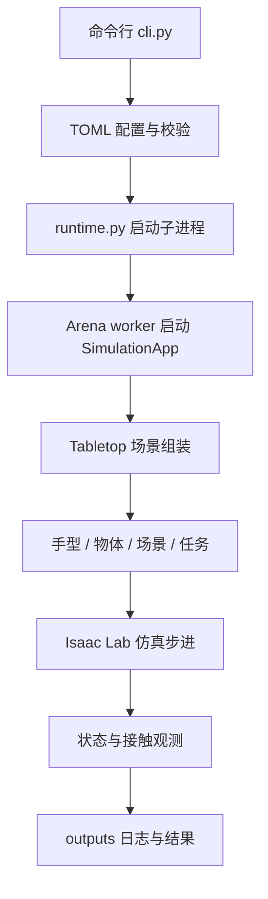

# 框架逻辑与目录

DexterousLab 按“配置 → 场景 → 控制 → 记录 → 评测”组织实验。配置决定使用什么，仿真组件负责运行，数据模块保存观测，评测模块解释结果。

## 从哪里开始读

按下面的顺序阅读，先理解一次场景运行，再看算法与数据。

| 顺序 | 文件 | 负责什么 |
|---|---|---|
| 1 | `scripts/dexlab` | 使用现有 Arena Python 启动 CLI |
| 2 | `src/dexterous_lab/cli.py` | 解析命令，分发到资产、场景或实验入口 |
| 3 | `src/dexterous_lab/config.py` | 读取 TOML、校验参数、生成场景配置 |
| 4 | `src/dexterous_lab/runtime.py` | 配置动态库路径、启动与回收仿真子进程、保存运行结果 |
| 5 | `src/dexterous_lab/integrations/arena/worker.py` | 启动 SimulationApp，创建并推进环境 |
| 6 | `src/dexterous_lab/scenes/tabletop.py` | 组装机器人、物体、桌子、地面、光照和任务 |
| 7 | `src/dexterous_lab/integrations/isaaclab/state.py` | 读取关节、手掌、物体与指尖接触状态 |

`scene run` 执行零动作冒烟测试；`experiment capture/replay/batch` 进入 `evaluation/runner.py` 和独立的 `evaluation/worker.py`。首次抓取尝试由 `scripts/first_grasp_experiment.py` 执行，目前仍是实验脚本，不是通用抓取策略。

## 根据需求找目录

以下源码目录均相对于 `src/dexterous_lab/`。

| 需求 | 目录或文件 | 说明 |
|---|---|---|
| 调整手型、关节与指尖映射 | `configs/robots/` | 每种手独立配置电机、腱和坐标 |
| 调整物体尺寸、质量与初始位姿 | `configs/objects/` | 几何、尺度、摩擦和位姿 |
| 调整桌面与仿真时间 | `configs/scenes/` | 桌面布局、dt 与 decimation |
| 调整任务目标 | `configs/tasks/` | 目标偏移、容差与超时 |
| 组合实验条件 | `configs/experiments/` | 选择手、物体、场景、任务与后端 |
| 查找、下载、转换和验证资产 | `assets/` | 来源目录、校验和、资产管理与程序化资产 |
| 新增手型适配 | `robots/` | HandRegistry 与手型 factory |
| 新增物体或取得物体网格 | `objects/` | ObjectRegistry、factory 与几何接口 |
| 修改场景组装 | `scenes/` | SceneBuilder 与 Arena 桌面环境 factory |
| 修改任务适配 | `tasks/` | 当前复用 Arena LiftObjectTask |
| 对接仿真 API | `integrations/` | Arena 启动和 Isaac Lab 状态、接触、物理检查 |
| 实现候选生成算法 | `grasp_generation/` | 生成器接口与 DexGraspNet 部分数学组件 |
| 修改候选记录格式 | `grasp_synthesis/candidate.py` | GraspCandidate 与字段校验 |
| 实现抓取执行与物理验证 | `grasp_execution/` | 验证器抽象接口与论文姿态适配 |
| 接入执行策略 | `policies/` | 当前提供 hold 策略注册 |
| 记录仿真轨迹与候选 | `data_collection/` | 状态流、数值 NPZ 与候选采集 |
| 写入候选数据集 | `datasets/` | JSONL 写入，拒绝覆盖已有数据 |
| 运行评测并汇总结果 | `evaluation/` | capture/replay/batch、成功判据与统计 |

根目录的 `assets/` 存放资产文件与清单，`src/dexterous_lab/assets/` 存放管理代码，两者用途不同。`scripts/` 是可执行工具，`examples/` 是用法示例，`tests/` 是不启动 Isaac Sim 的单元测试。`outputs/`、模型、数据集和缓存默认不提交 Git。

## 当前能力边界

- Allegro 桌面环境复用官方 KUKA + Allegro；Shadow 使用独立 embodiment。两者动作维度和安装关系不同。
- HandRegistry 与 ObjectRegistry 读取配置并调用 factory；资产目录中的手型不自动具备桌面任务控制能力。
- DexGraspNet 已迁移部分能量与优化数学组件，生成器仍需对接完整的可微手模型、物体模型和资产；不能称为完整复现。
- GraspValidator 是抽象接口；实验 worker 的抬升与保持检查不等于通用稳定性验证。
- 成功加载、完成步进与成功抓取分别记录。未验证的碰撞、稳定性和成功字段保持未知。

## 仿真 API 约定

- `ArenaEnvironmentFactory.build(cfg)` 返回环境描述，`ArenaEnvBuilder.make_registered()` 创建 Gym 包装环境。
- `Scene(assets=[...])` 组织资产；Arena 的 `AssetRegistry.get_asset_by_name()` 查找组件类。
- `DexterousLabTabletopEnvironment` 是自定义 factory；`TabletopEnvironment` 保留为兼容别名。
- Isaac Lab 状态通过 `env.unwrapped` 访问，避免依赖 Gym 包装层转发属性。
- 仿真模块延迟到 SimulationApp 启动后导入；CLI、配置和数据接口不导入 USD。
- 当前默认 100 个环境步对应 400 个 PhysX 子步，日志区分两种步数。
- `LiftObjectTask` 使用固定目标位置；完整抓取判断还需检查接触与保持。

代码修改约定见 [开发指南](development.md)。
