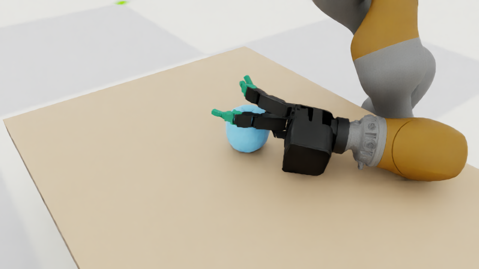
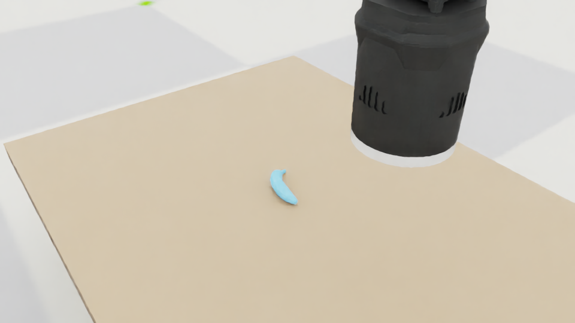

# DexGraspNet物体加入Isaac Sim · 2026-11-11

已实际下载作者镜像的 `meshdata.tar.gz`，并将罐头、香蕉、苹果三个物体加入现有Isaac Sim / Isaac Lab / Arena桌面场景。四次真实仿真均完成100环境步、400物理步；没有执行主动抓取，也没有声称抓取成功。

## 本次使用的物体

| CLI名称 | 原始object code | 碰撞片段数 | 仿真验证 |
|---|---|---:|---|
| `dgn_can` | `ddg-ycb_002_master_chef_can` | 4 | Allegro，100步通过 |
| `dgn_banana` | `ddg-ycb_011_banana` | 3 | Allegro与Shadow，各100步通过 |
| `dgn_apple` | `ddg-ycb_013_apple` | 8 | Allegro，100步通过 |

从DexGraspNet发布包中选出的是YCB衍生物体。原始文件保留CC BY-NC 4.0发布信息和YCB来源归属；本项目代码许可不覆盖第三方模型。

## 下载、准备与运行

```bash
dexlab assets download dexgraspnet --files meshdata.tar.gz --max-gb 1
dexlab assets prepare-dexgraspnet --objects dgn_can dgn_banana dgn_apple

dexlab assets validate --id dexgraspnet/ddg-ycb_002_master_chef_can --steps 100
dexlab assets validate --id dexgraspnet/ddg-ycb_011_banana --steps 100
dexlab scene run --hand allegro --object dgn_apple --physics physx --steps 100 --screenshot
dexlab scene run --hand shadow --object dgn_banana --physics physx --steps 100 --screenshot
```

文件包为345,939,166字节，约346 MB，本地SHA-256与来源保存在[下载记录](dgn-objects-20261111/download-provenance.json)。发布者未提供独立SHA-256，不能称为通过发布者哈希核验。包内有5,751个不同物体目录；这不等同于论文中通过抓取筛选的5,355个物体，更不表示所有目录已被本项目验收。

没有全量解出约1.73 GB的发布包。准备命令只解出三个指定物体的CoACD文件，保留原始OBJ、片段与URDF，先核对已有文件校验和，再生成USD。

## USD与配置位置

所有文件均位于 `/root/gpufree-data/DexterousLab/` 内。

| 物体 | 当前USD相对路径 |
|---|---|
| Can | `assets/objects/dexgraspnet/ddg-ycb_002_master_chef_can/processed/20261110T172649Z-dgn-prepare-0c2607aa/object.usda` |
| Banana | `assets/objects/dexgraspnet/ddg-ycb_011_banana/processed/20261110T172649Z-dgn-prepare-0c2607aa/object.usda` |
| Apple | `assets/objects/dexgraspnet/ddg-ycb_013_apple/processed/20261110T172802Z-dgn-prepare-484afcf0/object.usda` |

`object.usda`是Isaac Sim可直接读取的USD文本格式，包含单个动态刚体与多个凸片段碰撞。这里直接保留物体分解结构，没有将原始多固定链接URDF作为灵巧手关节模型导入。

配置由准备命令写入 `configs/objects/dgn_can.toml`、`dgn_banana.toml`、`dgn_apple.toml`。新机器上的运行名可能不同，以各物体 `preparation.json`中的路径为准。模型和本地生成配置不提交Git，需按上面的命令重新准备。

## 真实截图

| Allegro + Apple | Shadow + Banana |
|---|---|
|  |  |

截图来自实际Kit渲染器，960×540。第二张相机取景只显示Shadow部分模型；两图用于证明物体加载后的真实外观，不表示抓取动作或成功结果。

## 处理逻辑与边界

- `configs/downloads/dexgraspnet_samples.json`：样本名称与原始object code映射。
- `assets/dexgraspnet_samples.py`：只提取选定文件、校验已有来源、按统一尺度中心化并启动子进程。
- `assets/dexgraspnet_worker.py`：在SimulationApp启动后，用OpenUSD API编写刚体与网格碰撞；复用Arena的几何提取API核对导出网格。
- `objects/factories.py`与`scenes/tabletop.py`：直接复用既有外部USD与Arena Scene/Object接口，无需另一套场景构建逻辑。
- `integrations/arena/worker.py`：新增可选截图，其他零动作运行默认不启用摄像头。

源码路径除configs外均相对于 `src/dexterous_lab/`。参考的上游调用和数据格式来自 `research-repos/DexGraspNet/asset_process/decompose.py:export_urdf()`、`grasp_generation/utils/object_model.py:ObjectModel.initialize()`，本地commit为 `bd1b13d7248729af117e1d46aaa6266b147a3c7b`。未复制算法实现、未修改参考仓库或上游仿真源码。

原物体是归一化几何，不能直接当成真实米制日用品。这里明确设定最长边10 cm：`v_O = (v_source - center_source) * (0.1 / max(extents_source))`。尺寸与缩放比例保存在准备报告中。该尺度不保证与原论文任何抓取记录的尺度一致，后续重放抓取必须额外适配。

三个对象均使用试验质量0.1 kg、静/动摩擦0.7，未假称真实测量参数。发布包提供的是分解几何，使用统一蓝色显示，没有原商品纹理。苹果的一个片段被严格凸性检查拒绝，检查发现其与凸包体积相对差仅约2.59×10^-8；在派生模型中重算该片段凸包并记录差值，原始文件不变。相对体积差超过10^-5的非凸片段会拒绝，不能静默用整个物体凸包填平凹部。

## 实际验证

- 四次运行各有101次状态检查，机器人与动态物体加载、碰撞、质量、摩擦、正惯量、有限关节与物体状态均通过。
- 运行器导出了物体局部坐标网格，可供后续抓取算法读取。
- 184项单元测试通过，日志见[tests.log](dgn-objects-20261111/tests.log)。覆盖子集提取、越界路径、缺失物体、缩放、源文件保留、非凸片段拒绝与截图参数，既有测试继续通过。
- 复用准备命令返回already_prepared，没有覆盖已有模型或配置。
- 逐帧网格/桌面检查：Can最小间隙约-3.13 mm，结束约-0.42 mm；其他对象最小负间隙小于0.09 mm。不能据此宣称完全无穿透，也没有做全链接碰撞审计。

[运行结果与路径汇总](dgn-objects-20261111/summary.json)；完整请求、关节映射与仿真日志位于该目录的四个运行子目录。原始运行目录另外保留逐步 `states.jsonl`、`object_mesh.obj`及截图。目录名按UTC生成，对应上海时间2026-11-11。

以上是zero_action资产冒烟测试，`grasp_success=null`。未测试主动抓取、抗扰稳定性或其他五类数据源的全部模型；已下载文件包不表示全库可仿真。
